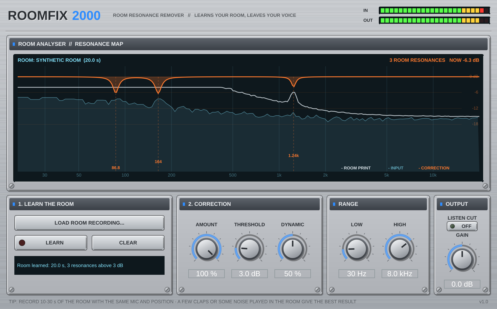
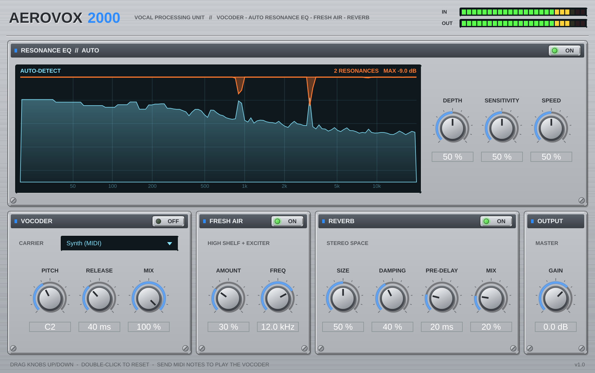

# AeroVox Audio — AeroVox 2000 + RoomFix 2000

Due plugin VST3 + Audio Unit per **Windows** e **macOS** (FL Studio, Logic Pro, Ableton, Cubase, Reaper...).
Download pronti: pagina **Releases** di questo repository.

---

## RoomFix 2000 — toglie le risonanze della stanza, non quelle della voce



**Idea:** le risonanze brutte della stanza sono *sempre alle stesse frequenze* (dipendono dalle pareti), mentre
quelle della voce si spostano con le note. RoomFix impara le prime da una registrazione dell'ambiente e corregge solo quelle.

### Come si usa
1. Registra **10-30 s della stanza** con lo stesso microfono e nella stessa posizione. Meglio se nella stanza c'è
   del suono che la fa "suonare": qualche battito di mani, del rumore rosa da una cassa o dal telefono.
   Il solo silenzio funziona se si sente il rumore di fondo, ma è meno preciso.
2. Metti RoomFix 2000 sulla traccia vocale.
3. **LOAD ROOM RECORDING...** e scegli il file, **oppure** premi **LEARN**, fai suonare la parte della traccia dove
   c'è solo la stanza (o manda la traccia della stanza nel sidechain) e premi di nuovo LEARN.
4. Il display mostra l'impronta della stanza (bianco), la voce (azzurro) e la correzione in tempo reale (arancione),
   con le frequenze delle risonanze trovate.

| Controllo | Cosa fa |
|---|---|
| **Amount** | Quanto del picco della stanza togliere (100% = lo appiattisce del tutto) |
| **Threshold** | Corregge solo i picchi che sporgono almeno di questi dB (default 3 dB) |
| **Dynamic** | 0% = EQ fisso. 100% = taglia solo nei momenti in cui la voce eccita quella risonanza |
| **Low / High** | Intervallo di frequenze in cui cercare (default 30 Hz – 8 kHz) |
| **Listen Cut** | Ascolti solo ciò che viene tolto |

Il profilo della stanza viene salvato dentro il progetto del DAW.

### Come funziona
1. **Analisi della stanza** (una volta, offline): FFT lunghissima (32768 punti, risoluzione ~1.5 Hz) mediata su
   tutta la registrazione. Si calcola la "forma media" dello spettro (media mobile di ~½ ottava, ripetuta 5 volte
   tagliando i picchi così che non la alzino) e si cercano i picchi che sporgono sopra di essa. Per ognuno si misurano
   **frequenza** (con interpolazione, precisione < 0.5%), **larghezza (Q)** e **quanti dB aggiunge la stanza**.
2. **Correzione** (in tempo reale, latenza zero): un filtro a campana stretto per ogni risonanza (max 16), centrato
   esattamente lì e con la stessa larghezza. **Regola fondamentale: non taglia mai più di quanto la stanza aggiunge**
   (dB misurati × Amount). Le altre frequenze non hanno nessun filtro, quindi la voce resta intatta.
3. **Modalità dinamica:** per ogni risonanza confronta l'energia nella banda stretta con quella di una banda larga
   attorno (normalizzata così che uno spettro piatto valga 0 dB). Se la voce in quel momento "accende" la risonanza
   il filtro taglia; altrimenti si apre (attacco 10 ms, rilascio 150 ms).

Test inclusi (stanza simulata con picchi a 87, 163 e 1240 Hz): frequenze trovate entro lo 0.2%, nessun falso picco,
dopo la correzione i picchi passano da +6/+8 dB a +1/+2 dB, toni della voce lontani dalle risonanze cambiano meno di 0.15 dB, CPU ~0.2%.

---

## AeroVox 2000


Plugin audio per voce (VST3 + Audio Unit) per **Windows** e **macOS**.
Funziona in FL Studio, Logic Pro, Ableton Live, Cubase, Studio One, Reaper, GarageBand e tutti i DAW VST3/AU.



## Moduli

Il segnale passa in quest'ordine: **Vocoder → Resonance EQ → Fresh Air → Reverb → Output**.
Ogni modulo ha il suo tasto **ON/OFF** con LED.

| Modulo | Cosa fa | Controlli |
|---|---|---|
| **Vocoder** | Vocoder a 20 bande. La tua voce (ingresso) "modella" il suono del carrier. | **Carrier** (Synth MIDI / Noise / Sidechain), **Pitch**, **Release**, **Mix** |
| **Resonance EQ // AUTO** | Analizza lo spettro in tempo reale, trova da solo le risonanze fastidiose (frequenze che "fischiano" o rimbombano) e le abbassa solo quando servono. Il display mostra lo spettro (azzurro) e i tagli applicati (arancione). | **Depth** (quanto taglia), **Sensitivity** (quanto è facile che una frequenza venga considerata risonanza), **Speed** (velocità di reazione) |
| **Fresh Air** | Aria e brillantezza: high-shelf morbido + leggero exciter armonico sugli acuti. | **Amount**, **Freq** |
| **Reverb** | Riverbero stereo con pre-delay e taglio dei bassi sul segnale riverberato (resta pulito). | **Size**, **Damping**, **Pre-Delay**, **Mix** |
| **Output** | Volume finale + meter IN/OUT a LED. | **Gain** |

Comandi: trascina le manopole su/giù, **doppio clic = valore di default**. Tutti i parametri sono automatizzabili dal DAW.

### Usare il vocoder

- **Synth (MIDI)** – suona note MIDI sulla traccia del plugin: il vocoder canta le note (fino a 8 voci, accordi ok). Se non arriva nessuna nota usa la nota del knob **Pitch** (effetto "robot").
  - *FL Studio*: crea un canale MIDI Out, imposta la stessa porta MIDI nelle impostazioni del wrapper del plugin (icona ingranaggio > Settings > MIDI input port).
  - *Logic Pro*: nel plugin, menu in alto a destra **Side Chain** > scegli la traccia strumento/MIDI da cui prendere le note.
- **Noise** – voce sussurrata / robotica rumorosa, non serve MIDI.
- **Sidechain** – usa un'altra traccia (es. un synth o un pad) come carrier tramite l'ingresso sidechain del DAW.

## Scaricare le versioni Windows e Mac

Le versioni pronte vengono compilate automaticamente da **GitHub Actions** (macchine Windows e Mac vere):

1. Crea un repository su GitHub e carica il contenuto di questa cartella (anche con *Add file > Upload files* dal sito).
2. Vai su **Actions**: parte da solo il workflow *Build AeroVox 2000* (circa 10 minuti).
3. A fine build, nella pagina del workflow, sezione **Artifacts**, scarichi:
   - `AeroVox2000-Windows` → `AeroVox 2000.vst3` + versione standalone `.exe`
   - `AeroVox2000-macOS` → `AeroVox 2000.component` (AU, per Logic), `AeroVox 2000.vst3`, app standalone e installer `.pkg` (Universal: Apple Silicon + Intel)
4. Per una release con i file allegati: crea un tag tipo `v1.0.0` (*Releases > Draft a new release*).

Le istruzioni d'installazione sono nel file `LEGGIMI.txt` dentro ogni zip.

## Compilare in locale (opzionale)

Serve CMake 3.22+ e: **Windows** Visual Studio 2022 (C++), **Mac** Xcode.

```bash
cmake -B build                       # Mac: aggiungi -G Xcode -DCMAKE_OSX_ARCHITECTURES="arm64;x86_64"
cmake --build build --config Release
```

I plugin finiscono in `build/AeroVox2000_artefacts/Release/`. JUCE viene scaricato in automatico.

Test automatici (Linux/Mac): `cmake -B build -DAEROVOX_BUILD_TESTS=ON`, poi
`AeroVoxTestHost "<percorso>/AeroVox 2000.vst3"` verifica trasparenza, riduzione delle risonanze, Fresh Air, riverbero, vocoder e salvataggio dello stato.

## Dettagli tecnici

- Formati: VST3 (Win/Mac), AU (Mac), Standalone. Windows 64-bit, macOS 10.13+ Universal.
- Latenza: 2048 campioni a 44.1/48 kHz (4096 a 88.2/96 kHz), compensata automaticamente dal DAW. È dovuta all'analisi FFT dell'EQ automatico.
- CPU: circa 3% di un core con tutti i moduli attivi.
- Mono e stereo, sidechain opzionale mono/stereo.

## Licenza

Basato su [JUCE 8](https://juce.com). JUCE è gratuito sotto licenza AGPLv3 (devi pubblicare il codice sorgente se distribuisci il plugin) oppure con una licenza JUCE (il piano *Personal/Starter* è gratuito sotto una certa soglia di fatturato). Se vuoi vendere il plugin a codice chiuso, controlla i termini su juce.com.
